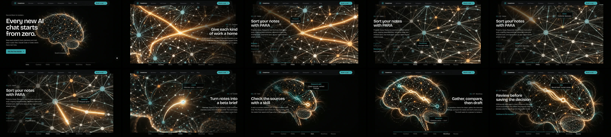
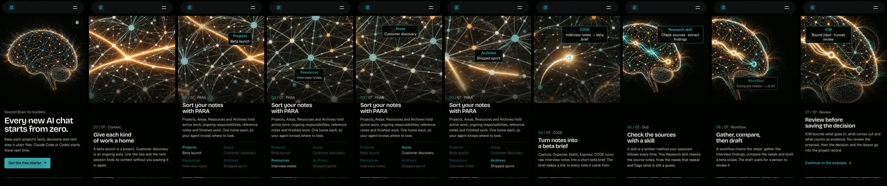

<div align="center">

# Second Brain Starter

**A workspace that connects your repositories to a memory your AI can continue.**

A free, plain-Markdown foundation for keeping facts, decisions, progress and next work available across Claude Code or Codex sessions.

[](LICENSE)
[](https://github.com/chohra-med/second-brain-starter/stargazers)

Created by [**Malik Chohra**](https://getwireai.com?utm_source=github&utm_medium=readme&utm_campaign=creator) · [Code Meet AI newsletter](https://codemeetai.substack.com?utm_source=github&utm_medium=readme&utm_campaign=newsletter)

Sponsored by [Builder AI OS](https://choumed.gumroad.com/l/builder-ai-os?utm_source=github&utm_medium=readme&utm_campaign=sponsor) and [CasaInnov](https://casainnov.com?utm_source=github&utm_medium=readme&utm_campaign=sponsor)

</div>

---

> **Need the learning layer too?** Start free here. **[Builder AI OS](https://choumed.gumroad.com/l/builder-ai-os?utm_source=github&utm_medium=readme&utm_campaign=builder-ai-os)** is the optional paid version. It adds prepared diagnostics, worked sessions and a controlled learning ratchet that records approved improvements in the changelog. [Free foundation and Builder AI OS](docs/free-and-builder-ai-os.md) sets the two side by side.

## What it is

Second Brain Starter sets up a workspace. A workspace is a folder of plain Markdown files. It keeps your facts, decisions, progress and next steps. An AI assistant can read them, so a new chat picks up where the last one stopped.

## Who it is for

It is for people who build software and people who do other work. You need a folder, a text editor and an AI assistant that can read local files.

## Start

1. Get a source copy: clone the [repository](https://github.com/chohra-med/second-brain-starter). Cloning gives the newest files. Or download and extract a release ZIP from [Releases](https://github.com/chohra-med/second-brain-starter/releases). A release ZIP gives the last published release, which can be older than this page.
2. Open the source folder in Claude Code, Codex CLI or the Codex app, with local file access.
3. Type:

> Set this up for me

The assistant asks for one project folder and shows the full setup plan. You approve that exact plan. Then it checks the result and opens your Home page. Keep the source copy separate from your project. The starter needs Node.js 22 or newer and has no production dependencies.

Ordinary web chat cannot do this setup. Your client and your operating system still control file access and permission prompts.

Three ways to start, from fastest to fullest. Each one drafts first and writes nothing until you say yes:

- [Quick start](template/03-Resources/Procedures/quick-start.md): index one to three repositories you name.
- [Init](template/03-Resources/Procedures/init.md): five questions, saved one at a time.
- [Complete init](template/03-Resources/Procedures/complete-init.md): the full question set, in sections.

Prefer the command line? These three commands do the same setup. Run them from the source copy. `$PROJECT` stands for the folder you want set up, as an absolute path.

```sh
node ./bin/second-brain.mjs init --target "$PROJECT"
node ./bin/second-brain.mjs init --target "$PROJECT" --apply YOUR_PLAN_DIGEST
node ./bin/second-brain.mjs verify --target "$PROJECT"
```

The first command prints the plan and its digest. The second applies that exact plan. The third checks the result. The shell variants and the damage cases are in [install and recovery](docs/install-and-recovery.md).

## What you get

| Part | What it is for |
|---|---|
| `Home.md` | The dashboard. It points to the next useful action. |
| Numbered folders, `00-Meta` to `05-Daily` | Rules, projects, areas, resources, archives and daily notes. Each record has one home. |
| [Keeping it clean](template/00-Meta/README.md) | Eight plain rules for where files go, how tasks look and when to review. |
| Skills | The starter ships sixteen shared skills. The initializer installs them as sixteen local skills in `.claude/skills/` and `.agents/skills/`. |
| Connect | Registers one repository you name with the workspace, one at a time. |
| Safety | Plan first. Typed approval for a folder that already has files. A new or empty folder takes a plain yes. Rollback for each receipt. Verify for the managed files. Private files ignored by git. |

The sixteen skills:

| Skill | What it does |
|---|---|
| `second-brain-context` | Loads the bounded context for one project before work. |
| `second-brain-capture` | Records one task with an owner, evidence and a next action. |
| `second-brain-close` | Matches roadmap status to progress evidence. |
| `second-brain-review` | Reviews one project before a handoff or each week. |
| `second-brain-learning` | Turns one confirmed miss into a bounded rule. |
| `second-brain-icm` | Guides changes to the workspace's rules, skills and routes. |
| `context-modes` | Loads bounded workspace context in one of three modes: default, one project or task, or full. |
| `end-session` | Closes a work session: writes the records, captures learning, lists the gaps and the next actions. |
| `icm-architect` | The bundled method that `second-brain-icm` relies on. |
| `humanizer` | Finds and removes common AI writing patterns. |
| `grill-me` | Settles a confused idea by checking real files and asking one question at a time. |
| `readme-generator` | Writes a README for a project. |
| `graphify` | Suggests links in your notes from a graph file. It needs an optional outside tool. |
| `usage-dashboard` | Prints how much Claude Code was used, from its transcript files on this machine: tokens, an estimated cost at list prices, and skill and command use. It runs only when you run it. |
| `scroll-story-component` | Adds a scroll-driven video story to a React site: it copies one runtime file into your project, then builds the chapters, reading pauses, phone framing and film encode on it. |
| `writing-skills` | Explains how to write your own skill. |

### What `scroll-story-component` builds



Recorded on a live page built with the skill ([casainnov.com/second-brain](https://casainnov.com/second-brain)). The film scrubs as you scroll and stops at each labelled moment so the text can be read. Watch the [desktop scroll-through](https://github.com/chohra-med/second-brain-starter/releases/download/v1.7.0/scroll-story-demo-desktop.mp4), the [phone scroll-through](https://github.com/chohra-med/second-brain-starter/releases/download/v1.7.0/scroll-story-demo-phone.mp4) or a [short GIF](https://github.com/chohra-med/second-brain-starter/releases/download/v1.7.0/scroll-story-demo.gif). On phones the frame is enlarged and pans toward the label:



## Day 1, day 7 and day 14

- **Day 1:** Start. Finish one small result and check it.
- **Day 7:** Run the [weekly review](template/03-Resources/Procedures/review.md).
- **Day 14:** Add your first own skill with `writing-skills`.

## Verify, update and roll back

Verify checks the files the starter manages. Run it after setup and after any update. Personalizing a managed record intentionally creates baseline drift. A managed record is a file the starter installs and verify checks, and baseline drift is the difference you leave in it on purpose. Verify names that path and exits nonzero. That is not proof of damage: review the named paths. To undo one applied change, run `rollback` with its receipt ID. The output labels and the recovery steps are in [verify, update and roll back](docs/verify-update-rollback.md).

## Glossary

- **Plan:** the list of files the setup will create, change or leave alone. Nothing is written until you approve it.
- **Digest:** a fingerprint of one exact plan. You type it to approve that plan and no other.
- **Managed block:** the marked section the starter owns inside `AGENTS.md`, `CLAUDE.md` or `.gitignore`. Your own text stays outside it.
- **Receipt:** the record of one applied change, with an ID.
- **Rollback:** undoes the changes of one receipt. It refuses if you edited a file that receipt wrote.
- **Verify:** checks that the managed files still match what was installed.
- **Connect:** registers one repository you name with the workspace. It can stage Spec Harness, a set of agent rules and commands, into that repository.
- **Skill:** a folder with a `SKILL.md` file. An assistant loads it for one kind of task.

## License and boundaries

The starter's own files are licensed under the [MIT License](LICENSE). You may use, copy, modify, publish, distribute, sublicense and sell copies of those files under those terms. Keep the copyright and license notices with substantial copies. Bundled third-party folders keep their own licences, listed in [ATTRIBUTION.md](ATTRIBUTION.md): `icm-architect` and `humanizer` are MIT-licensed by other authors, and the vendored Spec Harness is MIT-licensed too.

This is the free Second Brain foundation. It contains the folder layout, the per-project workflow, manual procedures, the local initializer and the `connect` command. It does not include any paid layer, a private application, a search of your disk for repositories (`workspace-plan` lists only the folders directly inside one parent folder you name, and `connect` registers one repository you name), a cloud-only assistant without local file access, a support call, installation service or outcome guarantee.

This package also bundles Spec Harness under `vendor/spec-harness/` with its own MIT license. The `connect` command stages its files into a repository you name. No code in `lib` or `bin` starts a process, so the starter never runs the vendored shell scripts. See [ATTRIBUTION.md](ATTRIBUTION.md).

Read [PRIVACY.md](PRIVACY.md), [ATTRIBUTION.md](ATTRIBUTION.md), and [CONTRIBUTING.md](CONTRIBUTING.md) before sharing a copy.

**Source version and releases:** [VERSION](VERSION) identifies these source bytes as `v1.7.1`. Use the repository's [Releases](https://github.com/chohra-med/second-brain-starter/releases) page to identify published tags and archives.

## Remove the starter

To remove the starter, first keep any Markdown files you want to retain. Then delete your copied workspace and, if you used Git, your local clone. Removing a local copy cannot revoke rights granted by the MIT License, or by the bundled folder licences listed in [ATTRIBUTION.md](ATTRIBUTION.md), for copies you already received.

## More

- [Install and recovery](docs/install-and-recovery.md): full setup, plan approval and repair of a damaged loader (the managed block in the root `AGENTS.md` or `CLAUDE.md`, which points an assistant at the workspace's rules).
- [Verify, update and roll back](docs/verify-update-rollback.md): what verify compares, its output and rollback.
- [Connect a repository](docs/connect-a-repository.md): one repository at a time.
- [First loop and projects](docs/first-loop-and-projects.md): your first project, the working loop and a second project.
- [Free foundation and Builder AI OS](docs/free-and-builder-ai-os.md): the free starter next to the optional paid layer.
- [ONBOARDING.md](ONBOARDING.md), [UPGRADING.md](UPGRADING.md), [CHANGELOG.md](CHANGELOG.md), [PRIVACY.md](PRIVACY.md), [SECURITY.md](SECURITY.md), [CONTRIBUTING.md](CONTRIBUTING.md) and [ATTRIBUTION.md](ATTRIBUTION.md).
