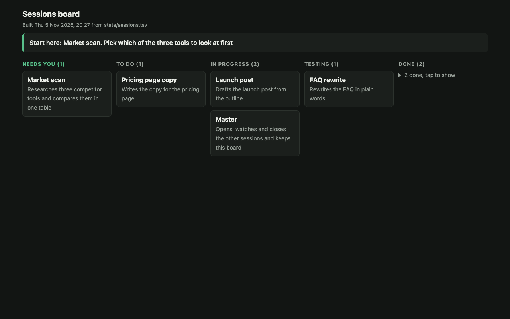
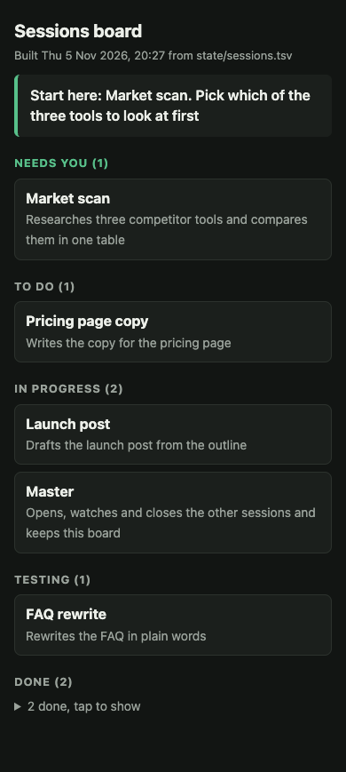
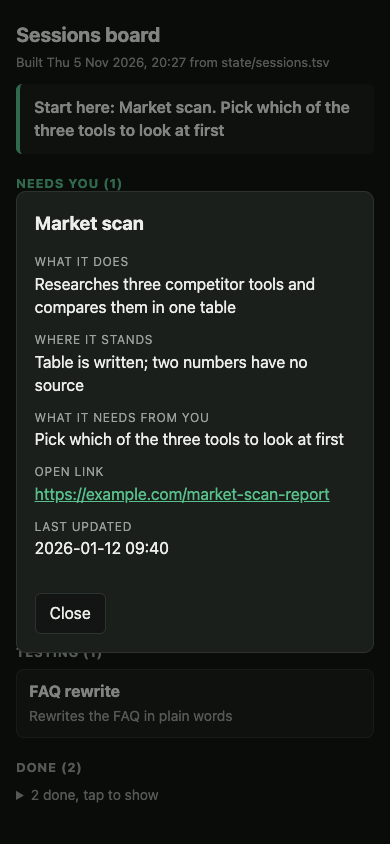

<div align="center">

# herdr session manager

**One master session opens one tab per task, watches them, and keeps one board that shows what waits on you first.**

<!-- slop-ok: negation-frame | required disclaimer, readers mistake a community kit for herdr's own project -->
A small kit for [herdr](https://herdr.dev): a master Claude Code session hands each task to its own herdr tab, tracks them on a local board, and closes a tab only after its report is on disk. Independent community work, not affiliated with herdr.

Created by [**Malik Chohra**](https://getwireai.com?utm_source=github&utm_medium=readme&utm_campaign=creator) · [Code Meet AI newsletter](https://codemeetai.substack.com?utm_source=github&utm_medium=readme&utm_campaign=newsletter)

Part of the free [Second Brain Starter](https://github.com/chohra-med/second-brain-starter) · Sponsored by [Builder AI OS](https://choumed.gumroad.com/l/builder-ai-os?utm_source=github&utm_medium=readme&utm_campaign=sponsor) and [CasaInnov](https://casainnov.com?utm_source=github&utm_medium=readme&utm_campaign=sponsor)

</div>

---

You talk to the master. The master hands each task to its own Claude session in its own herdr tab, tracks them on a plain board, and closes them only after their work is checked. Each session is an "employee": a short card that says what it does and what it must never do.



## What is in the box

| Part | File | What it does |
|---|---|---|
| Master command | `.claude/commands/master.md` | One page (43 lines). Orient, dispatch, watch, report, close. |
| End routine | `.claude/commands/end-session.md` | What a task tab runs before it closes: writes a report into `reports/`. Swap in your own if you have one. |
| Installer | `install.sh` | Copies the kit into your folder. Skips any file that already exists. |
| Dispatcher | `scripts/dispatch.sh` | Opens a herdr tab per task and starts `claude` in it. Also `status`, `wait`, `watch`, `finish`, `close`. |
| Its self-test | `scripts/dispatch-selftest.sh` | 29 checks against a fake herdr. Plants faults, proves the guards catch them. |
| Employees | `employees/_template.md` plus `researcher.md` and `writer.md` | One short card per employee. |
| Board | `state/sessions.tsv` and `scripts/board.py` | The master writes the TSV. The script turns it into one local HTML page. |
| Decision log | `state/decisions.md` | Where every decision lands, and where every new task starts. |

## Words used here

| Word | Means |
|---|---|
| herdr | A terminal workspace manager for AI coding agents: it holds several Claude Code sessions as tabs and shows each one's state (working, blocked, done). Install it first (see Set up); the kit does not install it. |
| tab, pane | A tab is one page of a herdr workspace, listed in herdr's sidebar. A pane is the terminal inside it. Each task gets its own tab with one pane, and `dispatch.sh` prints the pane id (like `w1:p3`). |
| master | The one session you talk to. It opens and watches the others. |
| employee | A task session that follows one card from `employees/`. |
| remote control | A Claude Code feature (`--remote-control`) that gives each session a link, so you can follow and answer it from your phone. |
| TSV | A text table with tab-separated columns. `state/sessions.tsv` is the board's data. |
| `touches:` | A line on a decision naming the tasks it affects, so the master knows which tabs to tell. |

## Who runs what

| Who | Does |
|---|---|
| You | Talk to the master. Say what you decide. Open `state/board.html`. Edit nothing by hand unless you want to. |
| Master (Claude) | Writes task files, runs `dispatch.sh`, edits `state/sessions.tsv` and `state/decisions.md`, runs `board.py`. |
| Task tab (Claude) | Does one task, ends with a `result:` line, runs `/end-session` when told. |
| `board.py` | Reads the TSV, writes the HTML. Nothing else. |

A card moves between columns when the master changes its `column` word in the TSV and re-runs `board.py`.

Three short definitions:

- **`result:` line.** The last line a task tab prints: `result: <what is done, where the files are, what is not done>`. If it needs you instead, `needs input: <the one question>`.
- **`wait`, `watch`, `finish`.** `wait <pane>` blocks until a tab is done or asks something. `watch` flags tabs whose screen has not changed for 15 minutes. `finish <pane>` runs `/end-session` in a tab, checks the report it wrote in `reports/`, then closes the tab. It refuses a tab that is not done or idle (a blocked tab would take the routine as its answer) and refuses the session's own pane.
- **Live tab.** A herdr tab with a Claude session still running in it.

## Set up in 5 minutes

You need herdr, Claude Code, `python3` (3.8 or newer, standard library only) and `bash` (macOS or Linux). Check two things first: `herdr --help` must list `agent`, `pane` and `tab`, and `claude --help` must list `--remote-control` (if it does not, open `scripts/dispatch.sh`, search for `remote-control`, and delete that word from the `claude` command line it finds). Remote control needs you to be logged in to a Claude account. If herdr lacks those three commands, this kit will not run on your herdr version; stop there.

Install herdr on macOS or Linux with the line from its own guide ([herdr.dev/agent-guide.md](https://herdr.dev/agent-guide.md); Homebrew, mise, Nix and Windows are on [herdr.dev/tui/docs/install](https://herdr.dev/tui/docs/install/)):

```sh
curl -fsSL https://herdr.dev/install.sh | sh
```

Open a terminal pane inside herdr and run everything below there, always from your second-brain folder unless a step says otherwise.

1. Copy the kit into your second brain. `<path-to-this-kit>` is the folder that holds this README: `learning/herdr-session-manager` inside your clone of the Second Brain Starter. The target must already exist. Nothing existing is overwritten:

```sh
cd <path-to-this-kit>
bash install.sh <your-second-brain-folder>
```

2. Check the dispatcher works on your machine. The test uses a fake herdr, so no tab opens:

```sh
cd <your-second-brain-folder>
bash scripts/dispatch-selftest.sh
```

It must end with `0 failed` (the passed count can change between versions). The installer creates every folder it needs (`state/`, `tasks/`, `reports/`, `employees/`, `scripts/`, `fixtures/`, `.claude/commands/`) and ships `/master` and `/end-session`.

3. Start the master in that herdr pane, from your second-brain folder (the master command is found there). `-n` names the session, and the second `"master"` names its remote-control link:

```sh
claude -n "master" --remote-control "master" "/master"
```

The first time Claude Code opens a folder it asks whether you trust it. Answer it here in the master. Every task tab opens in the same folder, so they will not ask again; a tab that does ask shows as blocked in herdr until you answer it.

4. Tell it a task in plain words: "research three competitor tools, then draft a launch post from the result". It writes a task file in `tasks/`, opens a tab for each (a few seconds each; the new tab shows up in herdr's sidebar), and fills the board. If no tab appears, the master prints the error from `dispatch.sh`; paste it back to the master.

5. The master runs `python3 scripts/board.py` after each change; you can run it yourself any time from your second-brain folder. The kit ships 7 made-up sample cards in `state/sessions.tsv` so the board is not empty on day one; the master replaces them on its first update, or you can delete the rows under the header. Open `state/board.html` in a browser (`open state/board.html` on macOS, `xdg-open` on Linux). Reload after the master says it updated the board.

If you start the master without the `--remote-control` flag, type `/remote-control` in it. Then you can follow and answer it from your phone.

## The flow

```
        you
         |  "do these three things"
         v
   +-----------+   writes   tasks/<name>.md   (job + decisions already made)
   |  MASTER   |--------------------------------+
   +-----------+                                |
     |  dispatch.sh start "<name>" tasks/<name>.md
     |                                          v
     |            +----------+  +----------+  +----------+
     +----------> | tab:     |  | tab:     |  | tab:     |   one herdr tab per task,
     |            | research |  | write    |  | review   |   each a real Claude session
     |            +----------+  +----------+  +----------+
     |                 |  result: ...  |            |
     |<----------------+---------------+------------+
     |
     |  checks the files exist, then: dispatch.sh finish <pane>
     |  (end-of-session routine, report lands in reports/, tab closes)
     v
   state/sessions.tsv  --board.py-->  state/board.html  --> you
   state/decisions.md  <-- every decision you make, pushed to every live tab it touches
```

## Add an employee

An employee is one file. Copy `employees/_template.md` to `employees/<name>.md` and fill five lines:

| Line | Write |
|---|---|
| Job | One sentence: what it turns into what. |
| Read first | The files it must read before starting. |
| May touch | The folders it may write to. Everything else is read-only. |
| Never | The lines it must not cross. |
| Reports | Keep the `result:` line. |

You can write the file yourself, or tell the master in plain words and let it write the file. For example, say: "Add a Reviewer. It reads a draft and lists what is unclear, line by line. It may only write to `reviews/`. It must never edit the draft." The master creates `employees/reviewer.md` from the template, shows it to you, and uses it for the next task. Read the card once. If a line is wrong, say so and it fixes the file. The folder in "May touch" does not need to exist; the employee creates it.

## Read the board



The file `state/sessions.tsv` has this header line, tab separated: `name`, `column`, `does`, `stands`, `needs_from_you`, `link`, `updated`. The `column` word is exactly one of the five names below.

| Column | Means |
|---|---|
| Needs you | A tab waits on a pick, a review or a yes. Look here first. |
| To do | Planned, not started. |
| In progress | A tab is working. |
| Testing | Built, and someone is checking it. |
| Done | Finished and closed. Folded away; tap to show. |

The **Start here** line at the top names the first card (in file order) in Needs you, with what it needs from you. With none, it says nothing needs you. Tap a card for a popup: what it does, where it stands, what it needs from you, and an open link. Empty columns disappear. The master writes every word on the board itself; `board.py` never guesses, and refuses a column name it does not know.



## The decision rule

A decision made in one tab must reach all the others, or the next tab asks you the same question again. The block `DECISIONS ALREADY MADE for this task` is the list of those decisions copied into the top of a task file (see `tasks/launch-post-2026-01-12.md`). When you decide something, the master (1) writes it to `state/decisions.md` with a `touches:` line, (2) sends it to every live tab it touches, and (3) starts every new task file with a block called `DECISIONS ALREADY MADE for this task`. Tabs are told to read the log before asking you anything.

## Settings

All optional, set as environment variables.

| Variable | Default | Meaning |
|---|---|---|
| `DISPATCH_MODEL` | `sonnet` | Model for new tabs. |
| `DISPATCH_MAX_TABS` | `6` | Most live tabs at once (the master counts as one). |
| `DISPATCH_END_CMD` | `/end-session` | What `finish` types into a tab before closing it. |
| `DISPATCH_REPORT_DIR` | `reports` | Where a finished tab must leave its report. |

Keep tab names to three words or fewer. The herdr sidebar cuts long names.

## What is not here

Comment threads on the board, a Send button, A/B experiments on decisions, a publishing calendar and more are deliberately left out for the paid version, Builder AI OS. See [BUILDEROS-LATER.md](BUILDEROS-LATER.md).

## Known limits

- `scripts/dispatch.sh` needs herdr's `agent`, `pane` and `tab` commands. The self-test fakes them; a real run is the only proof against your herdr version.
- `watch` only runs when the master runs it. Nothing schedules it.
- `finish` types `/end-session` (the default routine in this kit) and needs it to print `report: reports/<file>.md`. If your own routine does not, the tab stays open on purpose. If that happens, open the tab, check that the session wrote a file in `reports/`, and either have it print the `report:` line or run `scripts/dispatch.sh close <pane> --force` after you have read what it did.
- The self-test covers the guards of `finish` (it refuses a blocked tab and its own pane). A full `finish` or `wait` run needs a live herdr. They were run once by hand against herdr 0.9.5 (see Tested on). Run one small task end to end on your own version before you trust them.
- `wait` reads herdr's state the moment you call it. Called in the same second you typed into a blocked tab, it can return `blocked` before herdr has moved on. Wait a few seconds after typing into a tab.
- `status` and the capacity cap read every agent in your herdr session, not only this workspace. Tabs you run elsewhere in the same session show up in `status` and count against `DISPATCH_MAX_TABS`.
- `wait` blocks the master for up to 50 minutes. Use it for short tasks only; for long ones rely on `watch`.
- The capacity cap counts only sessions that read `working` or `blocked`, so two starts in the same second can both pass. Start tasks one at a time.
- The board cards show what each task does; the question for you shows in the Start-here line and in the popup.
- Not tested on Linux. The report check reads file times with `stat -c` first and `stat -f` second.

## Tested on

| What | Where | Result |
|---|---|---|
| `install.sh` into an empty folder, then `dispatch-selftest.sh` | macOS, herdr 0.9.5, Claude Code 2.1.330, 22 Nov 2026 | 16 files copied, 19 passed, 0 failed (29 after the `finish` guard, same day) |
| `start`, `status`, `wait`, `finish` on one real task | same | tab opened, task done, report written to `reports/`, tab closed |
| Three tabs at once (done, working, blocked) | same | `status` showed each state |
| Linux, Windows, other herdr versions | not tested | |

## Next to the Starter's lead-session skill

The Starter also ships `lead-session` and `session-sync`, which coordinate sessions through a shared folder of small files and need no herdr. This kit is the herdr way: every task is a visible herdr tab with its own state in the sidebar. Use one or the other for a run.

## License

MIT, under the Second Brain Starter's [LICENSE](https://github.com/chohra-med/second-brain-starter/blob/main/LICENSE). herdr itself is a separate project with its own license.
