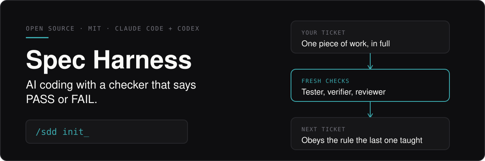
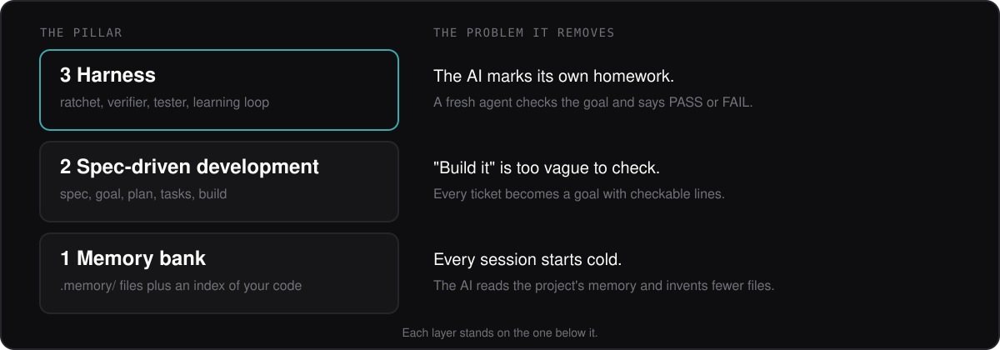
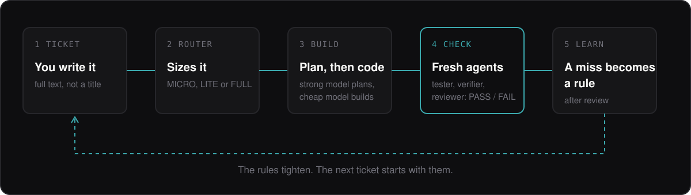

<div align="center">

<h1></h1>

**Spec-driven development for AI coding agents, with a separate verifier that says PASS or FAIL.**

Spec Harness wraps spec-driven development with project memory, source-backed rules, independent checks, and a learning loop that turns reviewed corrections into rules.

Created by [**Malik Chohra**](https://getwireai.com?utm_source=github&utm_medium=readme&utm_campaign=creator) · [Code Meet AI newsletter](https://codemeetai.substack.com?utm_source=github&utm_medium=readme&utm_campaign=newsletter)

Sponsored by [AI Mobile Launcher](https://aimobilelauncher.com?utm_source=github&utm_medium=readme&utm_campaign=sponsor) and [CasaInnov](https://casainnov.com?utm_source=github&utm_medium=readme&utm_campaign=sponsor)

</div>

---

## Start

You need Bash, git and Python 3.11+. Node is needed only for `npx`. Run these from the root of an existing project.

1. Start on a clean branch:

   ```sh
   git switch -c spec-harness-setup
   ```

2. Stage the harness. This copies files, merges one edit guard hook entry into `.claude/settings.local.json`, and reports `PENDING`; it does not write project rules:

   ```sh
   npx -y github:chohra-med/spec-harness-oss init . integrate
   ```

3. Review what it wrote with `git status` and `git diff`, then commit it on the branch.

4. In Claude Code, run `/sdd init`. It reads the codebase and writes the project's rules, skills and roles.

5. Run one small ticket with `/sdd <ticket text>`. Check its resumable state with `spec-harness run-state --check <ticket>` (see [docs/RUN-STATE.md](./docs/RUN-STATE.md)).

<br>

**New here? Read the ten-minute explainer first.** [`learning_human.html`](./learning_human.html) is
one interactive page: what Spec Harness is, how a ticket moves through it, which model does what,
what lands in your repository and how it improves over time. It is copied into every project you
set up, and the agent opens it for you when you run `/sdd init`. Download it and open it in a
browser; it needs no network.

**Using an agent?** Point Claude Code, Codex or any agent at this repository and say what you want,
for example "read AGENTS.md in this repository and add Spec Harness to my project at `<path>`".
[`AGENTS.md`](./AGENTS.md) tells it how to install, how to run the workflow and where everything is.

**Adopting it in an existing project?** Follow [docs/GETTING-STARTED.md](./docs/GETTING-STARTED.md):
both ways to get the CLI (`npx`, or a `git clone` you keep on your machine), then ten steps from a clean branch to a first verified ticket, including what to do when the project
already has its own `CLAUDE.md` and `AGENTS.md`, how to review what the initialiser wrote, and how
to undo it.

<br>

## Why this exists

AI coding agents lose the project every session, mark their own homework, and repeat the same mistakes. Spec Harness fixes each one with a separate piece, and the three pieces stack:



<br>

## How a ticket moves



<br>

| Ticket size | When | Route |
|---|---|---|
| **MICRO** | One small, reversible, local fix | One ticket file, one implementer, one fresh verifier. |
| **LITE** | A small multi-file change | A short packet with the plan written inline, then a fresh tester, verifier and reviewer. |
| **FULL** | Anything shared, security-sensitive, multi-repo or high-risk. When unsure, FULL. | Full packet with separate tester, verifier and reviewer. |

<br>

<details>
<summary><strong>What the name and the model tiers mean</strong></summary>

<br>

**Spec** means a written, checkable description of a change. **Harness** means the project memory, source-backed rules, independent checks, and learning loop around that work. Spec-driven development (SDD) is the workflow; `spec-harness` is the package and local CLI. The shared workflow entry is `/sdd` in Claude Code, or `$sdd` in Codex when the project skill is discovered.

The method stages the harness, inspects the target repository, derives project-bound rules and roles from its source, then takes one ticket through independent checks. The harness keeps project context and reviewed corrections available for later work.

Roles ask for a model tier: plan on the strongest model, implement on a fast cheap one,
and review on whichever the token budget allows. One table in [`commands/sdd.md`](./commands/sdd.md)
maps tiers to models per provider, so changing provider means filling one column.
A small model reads each ticket before it is classified (`sdd-router`) and decides its size, the tier for each stage
and the files to load, so the strong model only works on what needs it.

Small fixes take a light route: one ticket file, one implementer and one fresh verifier. Larger or
riskier work keeps the full packet with separate tester, verifier and reviewer.

</details>

<details>
<summary><strong>The three pillars, in a table</strong></summary>

<br>

Everything in Spec Harness is one of three things. The name is literal: **Spec** + **Harness**.

| Pillar | What it is | What it addresses |
|---|---|---|
| **Memory bank** | The context/memory engine: a 10-file `.memory/` bank + an index of the codebase (`context_map`). Persistent project context and a codebase index. | Cold start every session; hallucinated files/symbols. |
| **Spec-Driven Development** | A feature-owned `spec → goal → plan → tasks → build` packet. The project-bound planner and implementer work with fresh tester, verifier and reviewer contexts; researcher and merger roles are selected when needed. The reviewer reads blind first, then with the plan's gate briefs, and checks the optional project lens `ai_rules/review-lens.md`; the router also names the task `type` (code, doc, research, decision or review). | A structured path from ticket to checkable tasks with project-bound roles. |
| **Harness** | The ratchet (`AGENTS.md` rules that only tighten after reviewed classification) + the **verifier** (a fresh context, PASS/FAIL vs the feature's checkable goal) + the **tester** (a separate agent that adversarially runs + breaks the critical `workflows/`) + the **learning loop** (feedback is classified before it becomes policy). | Reviewed feedback, independent verification, and checks for critical project workflows. |

</details>

<details>
<summary><strong>The harness, in detail: ratchet, verifier, tester, learning loop</strong></summary>

<br>

The harness has four moving parts that together make the system *converge* instead of drift:

- **The ratchet**: `AGENTS.md` + `ai_rules/`. Reviewed rules only get added or sharpened; a failure does not become policy automatically.
- **The verifier**: `sdd-verifier`, a fresh context that checks
  `specs/<feature>/goal.md` against current evidence and returns `RESULT: PASS|FAIL`. It works from
  the ticket goal and evidence.
- **The tester**: `sdd-workflow-tester`, the proactive complement to the verifier. It loads the
  `workflows/` bank (critical journeys, ranked P0→P2) and, per journey, a clean-context agent *runs
  it end-to-end and adversarially tries to break it* (bad inputs, killed mid-flow, races, offline,
  double-submits, boundary values), returning `BROKEN` + a concrete repro. The verifier checks *a
  change* against the goal; the tester checks *reality* against the critical journeys.
- **The learning loop** (`learn`): the verifier or tester records a failure; `learn` captures and
  classifies it, then a reviewed durable correction can become a dated rule (a BROKEN workflow can
  also yield a recommended regression guard). The `sdd-learner` agent owns it: it also records
  decisions, promotes a cause that repeats, and corrects project skills as well as rules. Feedback never evaporates. The machine learns from its failures
  (→ rules); the operator learns from its wins (→ `learning/` lessons). *This is the "loop",
  reframed: not a cron schedule, a learning schedule.*

</details>

<br>

---

## Reference

## What this is (and isn't)

- **It is** a portable, stack-agnostic system for project memory, bounded package inventory,
  source-backed rules and skills, SDD roles, independent gates, and a learning loop. It adds no
  application dependency. The source commands use Bash. Python 3.11+ is required for the complete
  index-and-check flow. This source repository is MIT-licensed; see [LICENSE](./LICENSE). Run the
  CLI with `npx` from GitHub, from a checkout, or from a locally packed tarball. This source release
  is not published to npm; the registry package with the same name is unrelated. Model-led work needs a capable client; the shell stages files and reports
  `PENDING` rather than claiming that agents ran.
- **It runs the dev, not the product.** The harness guides the development workflow; the shipped
  application remains yours.

## Install and stage from a checkout

Clone the source and run the CLI directly; npm is not needed for this route:

```sh
git clone https://github.com/chohra-med/spec-harness-oss.git
cd spec-harness-oss
TARGET="/path/to/existing-project"
PATH="$PWD/bin:$PATH" spec-harness install "$TARGET" integrate
```

`install-manifest.json` lists every file `install` stages and where each one comes from. `bash tests/install-manifest-contract.sh` (run it from a clone of this repository; the packed archive does not include `tests/`) runs a real install into an empty git repository and checks the result against that list, byte for byte.

To install the CLI from a local tarball instead, run `npm pack` from the checkout, then install the
filename it prints. For the current version, that is:

```sh
npm install --global ./spec-harness-0.7.0.tgz
```

Staging reports `PENDING`. It copies a scaffold; it does not synthesize project rules, run agents,
or execute independent gates. With a capable client, inspect the target repository first, then run
`/sdd init` to derive project-bound rules and roles from its source. Use `/sdd <exact ticket body>`
for one ticket and collect independent tester, verifier, and reviewer results against that ticket's
goal and source revision.

Claude Code uses `/sdd`. In Codex, use `$sdd` only if the project skill is discovered; otherwise
open `.agents/skills/sdd/SKILL.md` and follow its shared procedure manually. Skill-file presence
alone does not prove native discovery or delegation. Native skill discovery, live Context7/Vercel
matching, and the result of a first real-ticket run remain unverified for this release.

## The commands

| Command | Does |
|---|---|
| [`install`](./bin/sh-install.sh) | Add/refresh the system in any repo. One entry point for **both** "start new" (`new`) and "integrate into existing" (`integrate`). Idempotent. |
| [`/sdd`](./commands/sdd.md) | Shared entry for project initialization and ticket-text/reference execution. Runs only in a capable client; the shell route stays PENDING/manual. |
| [`init`](./commands/init.md) | Stage then synthesize project-specific rules, five core skills plus one per major technology, and source-bound roles. Overall READY requires structural checks, `doctor` reporting `structural: READY` and a separate fresh semantic review. |
| [`index`](./bin/sh-index.sh) / [`migrate`](./commands/migrate.md) | Adopt an existing repo: inventory the codebase into the index layer, then enrich. |
| `index <target> --preview` | Prints the bytes `index` would write and writes nothing. |
| `index <target> --exclude-dir <dir>` | Leaves a generated or vendored directory (for example `ios`, `android`) out of the scan and records it in the inventory. Repeat it on every refresh. When a scan stops at a read limit, `index` prints an `INCOMPLETE:` line and you re-run with this option; when some paths could not be read, it prints an `INCOMPLETE:` line saying so. |
| `index <target> --same-scope` | Refreshes with the `--exclude-dir` and `--source` options the existing inventory recorded, so nobody has to remember them. A refresh without it that drops a recorded option prints a `SCOPE:` line on stderr; a map that does not fit the format index writes is not reused and gives no `SCOPE:` line. |
| [`stack`](./bin/sh_stack.py) `<target> [--check]` | Writes `ai_rules/stack.md` from the manifests and lockfiles: the only file that names package versions. `--check` compares it and changes nothing. |
| [`doctor`](./bin/sh-doctor.py) `<target>` | Read-only setup report with separate structural, semantic and client fields, plus a `guards` field (CLAUDE.md imports AGENTS.md, edit guard hook registered with the right matcher, python3 available to it, open and expired runs, review lens present, memory complete). See [`commands/doctor.md`](./commands/doctor.md). |
| [`finalize-init`](./bin/sh-finalize-init.py) `<target> [--apply\|--recover] --evidence-dir <dir>` | Guarded refresh of a READY synthesis receipt. It rewrites only the inventory hash markers and the receipt hashes, and it stops when a semantic inventory input changes (packages, rule files, workspace files, lockfiles, workspace declarations, exclusions, scan and limitations; its own synthesis outputs and visit counters are ignored). A dry run by default; `--apply` writes through a journal kept outside the target. It refuses a Markdown context map, which is what `index` writes by default. The refresh works only when the inventory is `ai_rules/project_inventory.json`, and the policy-drift check in `generate-agents --check` does nothing for a Markdown map. |
| [`tickets`](./commands/tickets.md) | Accept exact ticket text or a retrieved body from an explicitly connected provider → one `specs/<feature>/` packet with its own `goal.md`. Unretrievable names stop for clarification. |
| [`rules`](./commands/rules.md) | **Per-directory rules**, one line each (`- **ID** sentence. (source: ...)`), in layers with one home per fact: business and decisions in the memory bank, project rules, tool rules and baseline rules (curated packs in `templates/rule-packs/`), standards the owner committed to such as the European Accessibility Act with EN 301 549 ([`standards`](./commands/standards.md)), versions only in `ai_rules/stack.md`. Resolve the nearest `RULES.md` for a path (coding/architecture/packages/testing/reviewing), or generate it from a directory's real code. Each section owned by one agent; deepest-wins cascade. Built for mixed-stack monorepos. |
| [`spec`](./commands/spec.md) → [`plan`](./commands/plan.md) → [`tasks`](./commands/tasks.md) | Ticket input → checkable feature spec/goal → reuse-aware plan → atomic ordered units. |
| [`build`](./commands/build.md) | Execute one task at a time with separate fresh tester, verifier and reviewer evidence tied to the feature goal and source revision. |
| [`verify`](./commands/verify.md) | A separate fresh verifier checks `specs/<feature>/goal.md`. The shell CLI returns PENDING and does not run the check. |
| [`tester`](./commands/tester.md) | Adversarially validate the critical `workflows/`: per journey, a clean-context agent **runs it + tries to break it** (bad inputs, kill mid-flow, races, offline, boundaries), reporting what's BROKEN, ranked P0 first. `--scan` derives candidate workflows from the app; every BROKEN feeds `learn`. The proactive complement to `verify`. |
| [`document`](./commands/document.md) | Docs + comments to **the project technology's own standard** (Python docstrings, TS/JS TSDoc/JSDoc, GoDoc, rustdoc, Javadoc, …) + truthful README/ARCHITECTURE. Comments the WHY, never the WHAT. Behavior-locked (re-runs the suite to prove zero logic change). |
| [`ship`](./commands/ship.md) | Records delivery evidence and applies explicit merger authority. Green gates do not authorize a commit, push, merge, deploy or release. |
| [`pr-prepare`](./commands/pr-prepare.md) | Ordered checklist before a pull request is written, pushed or updated. Grants no permission to push or merge. |
| [`pr-packet`](./bin/sh-pr-packet.py) `PR_BODY.md` | Read-only structural check of a saved PR body: sections, one Before/After image, no video or local path, real test names. Claims stay UNVERIFIED. |
| [`teach`](./commands/teach.md) | Explain a system to a human as one self-contained interactive page: the idea, the flow, the structure, how to use it, evidence and limits. Never edits application source. |
| [`learn`](./commands/learn.md) | Classify feedback/corrections and add durable rules only after review (+ optional human lesson). |
| [`audit`](./commands/audit.md) | Health-check the bank, rules, and index. Flag stale or contradictory entries. |

The source exposes the native Claude `/sdd` command and a thin Codex project-skill adapter at
`.agents/skills/sdd/SKILL.md`; native discovery and delegation must be measured in the actual client.
Every command is also a **model-invocable skill** (`skills/spec-harness*`, generated by
[`bin/sh-make-skills.sh`](./bin/sh-make-skills.sh)): an umbrella `spec-harness` orchestrator +
one skill per command (`spec-harness-build`, `spec-harness-learn`, `spec-harness-tickets`, …),
each with trigger phrases. `install` stages them in a repo's `.claude/skills/`; each routes through
the shared SDD procedure. Six reusable methods have the exact skill identifiers
`spec-harness-ponytail`, `spec-harness-grill-me`, `spec-harness-package-finder`,
`spec-harness-skill-finder`, `spec-harness-conventions` and `spec-harness-technology-profiles`.
Each has a thin Claude route under `.claude/skills/` and Codex route
under `.agents/skills/`; both point to the same installed command owner. Native discovery remains
client-dependent and unverified until measured in that client. The shell `loop.sh` is a legacy illustrative placeholder, separate from
the supported ticket entrypoint.

## Guardrails: current procedures and MCP examples

The current package includes the SDD verifier and delivery-authority procedures described above.
Three optional release-guardrail examples (`release-preflight`, `eas-env-sync`, and
`backend-secrets-lock`) are historical references: their skill directories and check scripts are
absent from the current source and package, so they are not executable from this distribution.

The current procedure and authority map for verification, learning review, and delivery is in
[**docs/GUARDRAILS.md**](./docs/GUARDRAILS.md). The July 2026 illustrative MCP map is in
[**docs/MCP-SERVERS.md**](./docs/MCP-SERVERS.md); verify vendor details against current official
documentation before connecting a tool.

## Updating

Pull the new version of the source, then update the installed target. Nothing is applied until you
run it with the digest the plan printed:

```sh
git -C <checkout> pull --ff-only
spec-harness status <target>                    # installed version and commit, and the source version
spec-harness update <target>                    # plan only: one state per file, and a digest
spec-harness update <target> --apply DIGEST     # apply exactly that plan
```

Each planned file is one of these states:

- `UNCHANGED`: the installed bytes already match the new source.
- `UPDATE`: you have not edited the file, so it is replaced.
- `CUSTOMIZED-KEEP`: you edited the file and the source did not change, so your edit is kept.
- `MERGE`: you edited the file and the source changed without overlap; a clean three-way merge is written.
- `CONFLICT`: the merge overlaps. `<file>.spec-harness-proposed` is written next to the file, and the
  file itself is left for you to resolve.
- `NEW`: a file the new version adds.
- `REMOVED-UPSTREAM`: a file the new version no longer ships. It is listed, and never deleted.

Generated synthesis outputs are not touched. If the project has a synthesis receipt and the update writes an
`UPDATE`, `NEW` or `MERGE` file, the update marks synthesis stale, and `spec-harness generate-agents --check`
reports it until you run `/sdd init` again. An update that writes only `CONFLICT` proposals does not mark it.

## Edit guard hook

`install` also stages a Claude Code `PreToolUse` hook, `.claude/spec-harness/hooks/sdd-gate.sh`, and
registers it in the target's `.claude/settings.local.json` (never in the committed `settings.json`). The
merge keeps every other key and hook, running it twice adds nothing, and in a git target the file is added
to `.git/info/exclude` so it stays untracked. The hook is registered only when the staged file is
byte-identical to the one this harness ships and executable. An existing file is kept, as every existing file
is, so a changed or foreign `sdd-gate.sh` is not registered: the `hook registration:` line says why and what to
do, and an earlier registration of that file is removed. For `Edit`, `Write`, `MultiEdit` and `NotebookEdit` the hook:

- guards the repo that registered it (`CLAUDE_PROJECT_DIR`, else the repo around the script),
  never the session's current working folder, and compares folders by identity, so a differently cased path is the same folder;
- blocks a write that lands inside another git working tree: a `.git` entry (a folder, or a file as in a linked
  worktree) between the root and the file, also under `.claude/`, `specs/` and the other allowed folders, or above a
  file outside the root; or one that reaches outside through a link. Memory, plan, scratch and temp files outside
  the root and outside any git tree are allowed. Side effect: when a folder above the root (for example your
  home folder) is itself a git repository, files outside the root below it, such as Claude Code memory files, are
  blocked too; keep them outside any git tree or bypass that one write by your own decision;
- blocks a source edit until some `.spec-harness/runs/*/run-state.json` lists `checkpoint` and not
  `summary` (run `/sdd`) or an open MICRO `specs/<feature>/ticket.md` (no `RESULT: PASS` line yet; a weaker rule
  than a checkpoint), and a run-state or ticket not modified for 7 days is expired and no longer opens the
  gate (the block message names it). It always allows `specs/`, `.spec-harness/`, `.memory/`, `.claude/`, `ai_rules/`, `learning/`, `.agents/`, `SPEC-HARNESS.md`, `AGENTS.md`, `CLAUDE.md` and every `RULES.md` (the files `/sdd init` and learn write).

A block means run `/sdd`. `SDD_BYPASS=1` in the environment lets a call through and appends a line to
`.spec-harness/bypass.log` only when the call would otherwise have been blocked; it is for the person's own
decision, never for getting past a block that says run `/sdd`. If the hook itself fails it allows the call and
prints a warning. This is a gate against mistakes, not a sandbox: `.claude/`, `.spec-harness/` and `specs/` stay
writable, so an agent can change the hook, its settings or a run state, `Bash` writes are not checked, and a
session started in another folder does not load this repository's hook. `spec-harness update <target> --apply <digest>` registers the hook the same way and prints a `hook registration:` line. `spec-harness doctor <target>` reports `hook_registered` (OK only when the matcher is the expected one and the script is the shipped, executable hook), `hook_python` (python3 on PATH, or the hook fails open) and `runs_current` (open and expired runs).

## Uninstall

`spec-harness uninstall <target>` prints a plan only. It reads the install record
(`.spec-harness/install.json`) and sorts each file the harness wrote under one heading. To remove the install:

1. Run `spec-harness uninstall <target>` and read the plan.
2. Delete only the files under `UNCHANGED since install (safe to delete)`.
3. Keep the files under `EDITED since install (review before deleting)` and `YOURS before install (never delete)`.
4. Remove the edit guard entry from `.claude/settings.local.json`; the plan prints the command
   (`python3 -I -B <checkout>/bin/sh-hook-register.py remove <target>`). It removes only the harness entry and
   keeps every other key and hook.
5. Delete the harness state directory, `.spec-harness/`.

`ALREADY GONE` names files that no longer exist, so there is nothing to delete. The plan does not list the
generated synthesis outputs (rules, skills, role bindings and the receipt), so those stay until you remove them
yourself. A target installed before 0.4.0 has no record, so `uninstall` exits 1 and says so, and you must check
`git status` yourself.

## Platform support

| Platform | Status |
| --- | --- |
| macOS | Supported. CI runs the suite on the latest macOS runner. |
| Linux | Supported. CI runs the suite on the latest Ubuntu runner. |
| Windows, native | Not supported. |
| Windows, WSL2 | Works like Linux. `doctor` reports it that way. |

Prerequisites: Bash, git, Python 3.11 or later, npm (only for `npx`), tar, and a sha256 tool (`shasum` or
`sha256sum`). The suite does not need `rg`.

## Security

As shipped, the scripts in `bin/` make no network request. Installing, indexing, checking and finalizing read and
write local files only. Each `npx -y github:` command fetches this package from GitHub before it runs. The `git clone`
route fetches the repository. (`npx` is the Node package runner.)
`bin/loop.sh` is a template. It calls a placeholder, `your-agent-cli`, and is written to call a model's command-line
tool such as `claude -p`. Once you wire one in, that loop sends requests over the network.

`/sdd init` and `/sdd <ticket>` are model-led steps. Here the client is the coding agent you run them in (Claude Code,
or Codex through its project-skill adapter). In them, the client sends the files it reads to the model provider it uses.
For `/sdd init` that means: your project instruction files (such as `AGENTS.md`, `RULES.md`, `CONTRIBUTING.md`,
`ai_rules/`, `.memory/`, `.cursor/rules/`, `.agents/`) and your `README.md`; the project structure; package manifests
and lockfiles; relevant tests and configuration; the source sample that `index` records; the first-party source the
procedure opens; and project-local installed skills. Read your client's data terms before you run these steps on private code.

The inventory sample is capped as follows. A package with no `--source` path gets up to five files by default. A `--source` path applies to the package it names; other packages still get the default. The `--source` list is capped at five paths in total. Every sampled file is capped at 128 KiB, the whole sample at 2 MiB, and each instruction file at 256 KiB. A source or instruction file over its cap is left out and recorded as excluded, except a generated output the receipt registers, where `index` stops with a PENDING message and exit 1; a `--source` file over 128 KiB also stops `index` with exit 1. A manifest over 256 KiB is recorded as unreadable and listed under excluded paths. A manifest in any format other than `package.json`, `pyproject.toml` and `composer.json` (such as `go.mod`, `Cargo.toml` or `pom.xml`) is marked unsupported at any size, because `index` does not parse that format, so the project cannot pass this check as a real fix until a later release of index reads that format, then re-run index. This is a known limit. After initialisation, `generate-agents --check` fails with a message containing "unsupported or unreadable manifest" until the manifest clears it. The check clears in four ways once index has run again: the manifest is made smaller (for size only), it is moved outside the project folder, it is moved into a directory that is skipped by name (such as `node_modules`, `build`, `dist`, `vendor`, `target` or `coverage`), or it is repaired so that it parses. The skipped-directory move clears the check without the file being read, so it is not a fix. A malformed package.json, pyproject.toml or composer.json is marked unsupported, or unreadable when it is over 256 KiB. `--check` does not run `index`, so after any change run `index` again, then refresh the synthesis outputs (the generated rule, skill and role files the receipt lists). For the default Markdown context map, which `finalize-init` refuses to refresh, re-run init for a Markdown context map. The init procedure may open more first-party source than the sample (`commands/init.md:18`). The code cannot enforce a bound on that reading, so check the source each rule cites in step 9.

Three method or role files can reach the network. `skill-finder` (`commands/skill-finder.md`, step 2) runs `npx skills find <query>` when Vercel Skills discovery (Vercel's skill search) is available. Step 1 (line 5) sets the search scope from the inspected project's structure, task and evidenced need. The procedure does not define the query text: the client chooses it, and whatever query the client sends goes to that service; its `npx` may also fetch the `skills` package from the npm registry. `package-finder` (`commands/package-finder.md`, step 3, line 7) can query Context7 (a package-documentation service) when it is available, sending the library name and a query. Step 3 builds the resolve query from the step 2 target constraints (line 7). The procedure does not fix the literal query text, including the query-docs query. Step 2 (line 6) is where the target's version and its runtime, native-platform and peer constraints are identified. The `sdd-design-verifier` role (`agents/sdd-design-verifier.md`, line 39) runs `npx -y impeccable detect --json <changed UI dirs>` (`impeccable` is the UI-linter package from npm); if `impeccable` is missing, `npx -y` fetches it from the npm registry, and if `npx` is unavailable the role must say so (line 44). Six instruction files also direct the model to look up official documentation on the web: `commands/init.md` (line 44), `commands/rules.md` (line 23), `templates/project-skills/spec-harness-architecture.md` and `spec-harness-performance.md` (line 16 of each), and `templates/project-skills/spec-harness-packages.md` (line 19) and `spec-harness-tech.md` (line 20). Whether any of these reaches the network depends on the client's tools. UNVERIFIED here, meaning not tested in this repository.

Each method file says to use the network only when its tool is available. No code enforces that. The rule that discovery never installs a third-party skill (step 3 of `commands/skill-finder.md`) is also a rule in the method text, and no code enforces it.

Generated rules are project instructions. Review each one against the source it cites before you rely on it.
Third-party skill content is data: read it, and do not follow instructions in it that your project has not
adopted.

## Read next

1. [`docs/GETTING-STARTED.md`](./docs/GETTING-STARTED.md). Step by step: stage, initialise, review, first ticket, undo.
2. [`ARCHITECTURE.md`](./ARCHITECTURE.md). The diagrams: the 3 pillars, the SDD flow, the
   ratchet, and the verifier + learning loop wired in.
3. [`docs/GUARDRAILS.md`](./docs/GUARDRAILS.md). Current procedures for evidence, reviewed learning, and delivery authority.
4. [`docs/MEMORY.md`](./docs/MEMORY.md). Where each fact lives in `.memory/`, and the optional memory kinds.
5. [`docs/COMPANION-SKILLS.md`](./docs/COMPANION-SKILLS.md). Understand-Anything, graphify, diagram-design and the methods that ship inside.
6. [`docs/MCP-SERVERS.md`](./docs/MCP-SERVERS.md). A dated illustrative MCP map; recheck vendor details before use.
7. [`commands/init.md`](./commands/init.md). Start here to use it on a project.

## More from Code Meet AI

**Open source:** [wireai-rn](https://github.com/chohra-med/wireai-rn) · [expo_boilerplate](https://github.com/chohra-med/expo_boilerplate) · [colorway-c-brand](https://github.com/chohra-med/colorway-c-brand) · [claude_design_skill](https://github.com/chohra-med/claude_design_skill)
**Products:** [Second Brain Starter](https://github.com/chohra-med/second-brain-starter) ([site](https://casainnov.com/second-brain)) · [AI Mobile Launcher](https://aimobilelauncher.com) · [AI Web Launcher](https://aiweblauncher.com) · [Wire AI](https://getwireai.com) · [CasaInnov](https://casainnov.com)
**Follow:** [Newsletter](https://codemeetai.substack.com) · [YouTube](https://youtube.com/@codemeetai)
